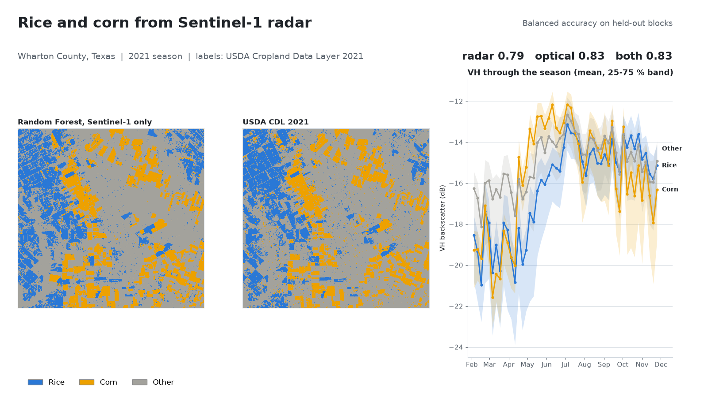
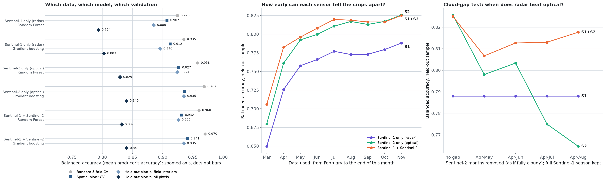
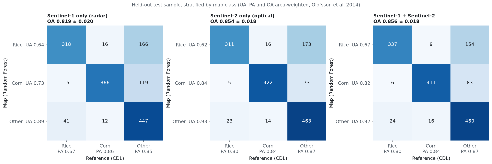
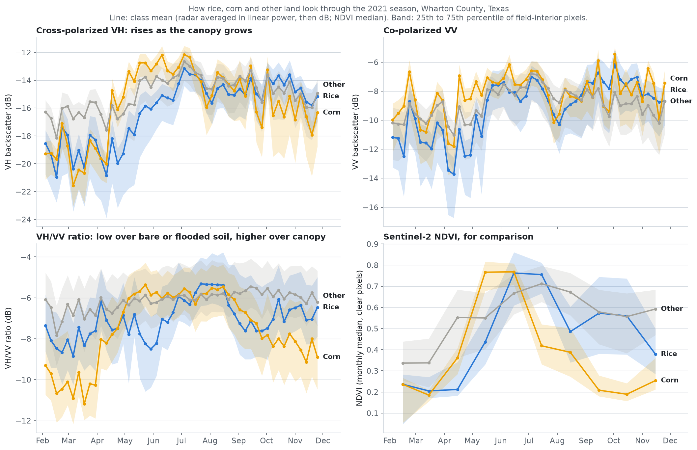
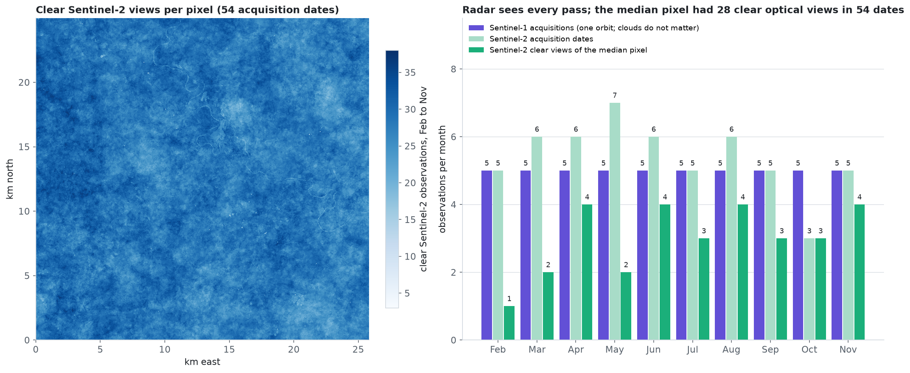

# Rice vs corn from Sentinel-1 radar: when does radar beat optical?

A Random Forest maps **rice, corn and everything else** in the Texas Gulf Coast rice belt (Wharton County, 2021) from a **Sentinel-1 radar time series**. The same model is also trained on Sentinel-2 optical data alone and on both together, so the three can be compared on the same samples. As in my [Sentinel-2 land-cover project](https://github.com/landon2199/sentinel2-landcover-ml), the focus is honest accuracy: held-out spatial blocks, random vs spatial cross-validation, and area estimates with confidence intervals (Olofsson et al. 2014).



*The map covers the whole box, including the blocks the model was trained on, so it looks cleaner than an unseen area would. Every accuracy number below comes only from the held-out blocks.*

## Summary

- **Question:** Can a Sentinel-1 radar time series separate rice from corn on the Texas Gulf Coast, and when does radar beat optical Sentinel-2?
- **Answer:** On held-out blocks, balanced accuracy was 0.794 for radar, 0.829 for optical and 0.832 for both. Optical won in 2021, a fairly clear year. When April to July of optical data was removed, optical fell to 0.775, below radar (0.788), while the combined model held above 0.80. Rice area: 22.19 ± 1.96 km² against 21.85 km² in the CDL.
- **Main limitation:** The labels are the USDA Cropland Data Layer, itself a classified map, and the flood and ratoon readings have no field records behind them.

## My role

I'm a geographer: B.S. in Geography with a GIS background, now an M.S. Geography student at Texas A&M. I ran this project as the human on the loop. I owned the question, the standards and every decision about what gets published, and used Claude Code (Anthropic) as the programmer.

- **Problem framing:** I defined the question, approved the study area and data, and set what a useful, defensible answer looks like.
- **Key call:** rice against corn on the Texas Gulf Coast, with a fair test of when radar beats optical, because choosing between Sentinel-1 and Sentinel-2 is a core decision in crop mapping.
- **Standards:** spatially held-out validation where the data allow, methods grounded in peer-reviewed literature, honest uncertainty (intervals and stated limitations), and a stated cost for every design choice.
- **Oversight at every stage:** I reviewed the plan, the intermediate results, the figures and the write-up, challenged anything unclear or unsupported, and sent work back until it met the standard.
- **Quality control:** before publishing, every number was traced to the project's results, the references checked and the tests run. The final call on what is reported, and what is stated as a limitation, is mine.

Commits made with Claude Code carry its `Co-Authored-By` line.

## Results

All numbers come from one run (`python run.py`, seed 42) and are written to [`results/metrics.json`](results/metrics.json). The class curves are in [`results/class_curves.json`](results/class_curves.json).

**Study area:** -96.49 to -96.23 °E, 29.26 to 29.48 °N (Wharton County, Texas, around El Campo), about 25.8 × 25.0 km (645 km²), UTM 14N, 20 m pixels (1291 × 1249). The box was chosen from the 2021 CDL as the 25 km window where rice and corn both cover the largest share.
**Season:** 1 February to 30 November 2021. **Labels:** USDA Cropland Data Layer (CDL) 2021: **rice 17.9 %**, **corn 17.2 %**, **other 64.9 %** of the area. "Other" is mostly grassland/pasture (21 %), other hay (10 %), cotton (8 %), fallow/idle cropland (6 %) and sorghum (4 %).

### Key terms

- **Backscatter** is the share of the radar pulse that bounces back to the satellite. Smooth water reflects the pulse away and looks dark. Plant canopies scatter it in all directions, so part of it comes back.
- **VV and VH** are polarizations. VV is sent and received vertically; it reacts most to the soil or water surface and to upright stems. VH is sent vertically and received horizontally; it comes mostly from scattering inside the canopy, so it grows with plant biomass.
- **dB (decibels)** is 10 × log10 of the backscatter power. -10 dB is a tenth of the power of 0 dB, and -20 dB a hundredth.
- **Speckle** is the grainy noise in every radar image. It comes from many scatterers inside one pixel adding up at random. Averaging several looks or dates reduces it.
- **RTC (radiometric terrain correction)** removes brightness changes caused by slopes facing toward or away from the radar. The Gulf Coast is flat, so it matters little here.
- **Balanced accuracy** is the mean of the producer's accuracies of the three classes. **Producer's accuracy** is the share of real (CDL) rice that the map calls rice. **User's accuracy** is the share of mapped rice that is rice in CDL.

### Radar vs optical vs both

Balanced accuracy of the Random Forest (gradient boosting in brackets):

| Features | Random 5-fold CV | Spatial block CV (2 km) | Held-out blocks, field interiors | Held-out blocks, all pixels |
|---|---|---|---|---|
| Sentinel-1 only (60 radar features) | 0.925 (0.935) | 0.907 (0.912) | 0.886 (0.896) | **0.794** (0.803) |
| Sentinel-2 only (140 optical features) | 0.958 (0.969) | 0.927 (0.936) | 0.924 (0.935) | **0.829** (0.840) |
| Sentinel-1 + Sentinel-2 | 0.960 (0.970) | 0.932 (0.941) | 0.926 (0.935) | **0.832** (0.841) |



- **In 2021, optical data alone beat radar alone.** Over the full season, Sentinel-2 scored 0.829 on the held-out blocks and Sentinel-1 0.794. Adding radar to optical raised it only to 0.832. Optical also led at every point of the season (middle panel). This box was not cloud-starved in 2021: the median pixel had 28 clear Sentinel-2 views out of 54 dates.
- **Radar wins when the optical growing season is lost to clouds.** In the cloud-gap test, whole months of Sentinel-2 were removed, as if every scene had been cloudy, and the models were retrained (right panel). With April to July missing, Sentinel-2 alone fell to 0.775 and with April to August missing to 0.765, both below Sentinel-1 alone (0.788 on the same sample). Sentinel-1 + Sentinel-2 stayed between 0.807 and 0.818 in every gap scenario, because radar filled in the missing months. This is a simulation on one site; it shows what radar protects against, not what happened in 2021.
- **Field edges cause most of the error.** On field-interior pixels (all 3 × 3 neighbours share the CDL class, 78 % of test pixels), Sentinel-1 reaches 0.886 and Sentinel-2 0.924. On all pixels, including edges, they drop to 0.794 and 0.829. At 20 m, an edge pixel mixes the field with a levee, road, ditch or the next field, and the 30 m CDL label itself is uncertain there.
- **Random CV is optimistic, and patch-shaped samples make it much worse.** With scattered training pixels, random CV is 1.7 to 3.3 points above spatial CV. When the same number of pixels is drawn as 5 × 5 patches (like digitized polygons), random CV reports 0.976 (S1) to 0.997 (S1+S2), while spatial CV gives 0.908 to 0.936. This matches the pattern described by Roberts et al. (2017).
- **Gradient boosting is about one point better** than Random Forest in every setting.

### Map accuracy and areas on the held-out blocks (Random Forest)

34 randomly chosen 2 km blocks (134 km², 335,500 pixels) were held out, and training pixels within 200 m of them were removed. Accuracy and area were estimated from a stratified random sample of 500 pixels per mapped class (n = 1,500 per model) with the Olofsson et al. (2014) estimators. The census column counts CDL over every test pixel.

| Model | Overall accuracy (± 95 % CI) | Rice UA / PA | Corn UA / PA | Other UA / PA |
|---|---|---|---|---|
| Sentinel-1 only | 0.819 ± 0.020 | 0.64 / 0.67 | 0.73 / 0.86 | 0.89 / 0.85 |
| Sentinel-2 only | 0.854 ± 0.018 | 0.62 / 0.80 | 0.84 / 0.84 | 0.93 / 0.87 |
| Sentinel-1 + Sentinel-2 | 0.856 ± 0.018 | 0.67 / 0.80 | 0.82 / 0.84 | 0.92 / 0.87 |

| Model | Class | Mapped km² | Estimated km² (± 95 % CI) | CDL census km² |
|---|---|---|---|---|
| Sentinel-1 only | Rice | 24.31 | 23.24 ± 2.34 | 21.85 |
| | Corn | 23.65 | 20.16 ± 1.53 | 20.07 |
| | Other | 86.24 | 90.80 ± 2.69 | 92.28 |
| Sentinel-1 + Sentinel-2 | Rice | 26.38 | 22.19 ± 1.96 | 21.85 |
| | Corn | 21.19 | 20.66 ± 1.55 | 20.07 |
| | Other | 86.63 | 91.34 ± 2.42 | 92.28 |

- **All 95 % intervals contain the CDL census area**, for all six models (three Random Forests and three gradient-boosting baselines). The maps overstate rice (for example 26.4 km² mapped vs 21.9 km² in CDL), because training used equal numbers of pixels per class while rice covers only 18 %. The sample-based estimate corrects this.
- **Rice user's accuracy is the weak point (0.62 to 0.67).** About a third of the pixels mapped as rice are "other" in CDL. Of those (Sentinel-1 + Sentinel-2 model), 70 % are CDL **fallow/idle cropland** and 35 % lie at field edges. Fallow fields in a rice rotation may be flooded or carry volunteer growth, so they can look like rice to both sensors; CDL may also be wrong on some of them. Without field visits this cannot be settled.
- **Corn is mostly confused with sorghum.** Of the "other" pixels mapped as corn, 81 % (S1+S2) and 60 % (S1 only) are CDL sorghum, which is planted and grows on a similar calendar.



### What the radar curves show



Lines are class means of field-interior pixels on each of the 50 Sentinel-1 dates (averaged in linear power, then converted to dB). Bands are the 25th to 75th percentiles.

- **Corn greens up first.** Corn VH rises from about -20 dB in early April to about -13 dB by mid-May and stays high until it falls in late July, at harvest.
- **Rice stays dark longer.** Rice VH stays near -18 to -20 dB through April, rises through May and June, and peaks near -13 dB in early July.
- **A flood signal, but not the classic one.** In late May and early June, rice VV rises (to about -7.6 dB) while VH/VV drops to about -8.5 dB, as low as on the bare fields of March (corn is about -5.7 dB then). Strong VV with weak VH is what a flooded field with young plants is expected to give, because the pulse bounces between the water and the upright stems. I read this as the delayed permanent flood. There is no deep "dark water" dip at planting, the classic signal of transplanted rice in Asia: Texas guidelines describe seeding into dry soil or water-seeding, and the permanent flood comes only once the seedlings have 4 to 5 leaves.
- **A second rice growth after the August harvest.** Rice VH dips in early August, at harvest, then stays mostly above corn from late September to November (about -14 dB vs -15 to -17 dB for corn on most dates). NDVI shows the same: it drops from 0.76 in July to 0.49 in August, then recovers to 0.57 in September. This fits ratoon cropping (regrowth from the stubble), but the data cannot say which fields were ratooned.
- **Which dates matter.** In the Sentinel-1 model, shuffling the second half of April costs the most balanced accuracy (2.0 points), then mid-May (1.4) and early March (1.0). These are the weeks when corn is growing and rice fields are still bare or newly flooded. In the combined model, April optical data dominate (9.4 points) and radar months add little, because the optical bands already carry the same information when they are available ([figure](figures/feature_importance.png)).

### The optical data gap



- Sentinel-1 (one relative orbit, Sentinel-1A and 1B together) imaged the box **every 6 days: 50 dates, 5 per month, all usable**.
- Sentinel-2 imaged it on 54 dates, but the median pixel was clear on only **28 (52 %)**, from 3 to 38 depending on the pixel. In February and May the median pixel had only 1 and 2 clear views. Only 41 dates had at least 5 % clear sky over the box.
- In 2021, cloud never wiped out a whole month: fewer than 0.2 % of pixels had no clear view in any month. That is why optical still won here (see the cloud-gap test above for when it would not). Accuracy also barely changed with a pixel's number of clear views (0.81 to 0.83 for Sentinel-2 across the three thirds of test pixels).

## Decisions

- **I chose Texas rice next to corn, in 2021.** Published radar rice methods mostly come from transplanted paddy rice in Asia. Texas rice is drill-seeded and flooded later, so it tests whether the signal holds under a different practice. 2021 is the last year of the Cropland Data Layer on the Planetary Computer, and both Sentinel-1 satellites were still working (a pass every 6 days).
- **I trained radar-only, optical-only and combined models on the same sample points.** That makes the comparison fair: any difference comes from the data, not the sample.
- **I tested a cloud gap by removing optical months, because 2021 was not cloudy enough to show one.** The simulation shows what radar protects against. I report it as a simulation, not as what happened.
- **I learned the rice signature from labels instead of using published flood-threshold rules.** Those rules expect a flood at planting, which Texas fields don't have. The cost is that the model needs labels.
- **I used one descending orbit only.** Every date then has the same viewing angle and time of day, so changes in backscatter come from the crops, not the geometry. The cost is fewer dates than mixing in other orbits would give.
- **I kept Random Forest as the main model although gradient boosting scored about one point higher.** The ranking that answers the question (Sentinel-1 below Sentinel-2, combined highest) is the same with both models, and Random Forest is the model used in several of the cited rice studies (Singha et al. 2019; Ferrant et al. 2017; Torbick et al. 2017), so the results compare directly. Gradient boosting is reported beside it in every table.
- **I held out 2 km blocks and reported field interiors separately.** This shows that most of the error sits on field edges, where a 20 m pixel mixes two fields and the 30 m label is uncertain.

## Background

Published rice maps from Sentinel-1 mostly use the flooding signal of transplanted paddy rice: backscatter drops when the field is flooded, then rises as the canopy grows, and VH tracks growth better than VV (Nguyen et al. 2016; Bazzi et al. 2019). Methods range from phenology rules (Xiao et al. 2006; Dong & Xiao 2016) to Random Forest on Sentinel-1 time series (Torbick et al. 2017; Singha et al. 2019), with optical data added where clouds allow (Ferrant et al. 2017). Texas rice is different: the guidelines describe seeding into dry soil (or water-seeding), with the permanent flood set only when the seedlings reach the 4 to 5-leaf stage, and many fields are ratooned after an August harvest (Texas A&M AgriLife 2012). Most published accuracies come from random or unstated splits and are not directly comparable. This project follows the per-pixel Random Forest approach with CDL labels, but adds a rice-vs-corn class, an S1 vs S2 comparison, and spatial-block validation with area estimates. The full review (20 sources, each checked against its DOI record or web page) is in [docs/literature_review.md](docs/literature_review.md).

## Method

1. **Sentinel-1.** Radiometrically terrain-corrected (RTC) VV and VH backscatter from the Microsoft Planetary Computer `sentinel-1-rtc` collection (gamma-nought, linear power). Only **descending relative orbit 143** is used (about 12:23 UTC, early morning local time), so every date has the same viewing geometry. All 50 acquisitions from 4 February to 25 November 2021 cover the whole box (25 from Sentinel-1A, 25 from 1B). The code checks that the values are linear power (median VV 0.078 = -11.1 dB and VH 0.015 = -18.2 dB on the first date) and that every date has data on 100 % of the box.
2. **Speckle.** Speckle is reduced in two steps, both by averaging power in linear units (the mean of dB values would be biased low). First, the 10 m pixels are averaged to 20 m. The 10 m RTC pixels are oversampled: the product's spatial resolution is about 20 × 22 m, with about 4.4 equivalent looks (product metadata; ESA GRD specification). Second, the dates in each half-month (2 or 3 per window, 20 windows) are averaged. No spatial speckle filter was added, because it would blur field edges, which are already the largest error source.
3. **Radar features (60).** For each half-month: VV (dB), VH (dB) and VH/VV (dB difference, i.e. the ratio of mean powers).
4. **Sentinel-2.** All 54 L2A dates (tile 14RQT, processing baselines 02.12 and 03.00) were read for the cloud mask. Clear pixels are Scene Classification Layer classes 2, 4, 5, 6 and 7. The 41 dates with at least 5 % clear sky over the box were composited into monthly medians at 20 m. The baseline 04.00 offset of -1000 DN (from 25 January 2022) is handled in code, but no 2021 scene needs it.
5. **Optical features (140).** For each month: bands B2-B8, B8A, B11, B12, plus NDVI, LSWI (land surface water index, (B8A - B11)/(B8A + B11)), NDWI and MNDWI. A pixel with no clear view in a month gets a missing value, which scikit-learn's Random Forest and gradient boosting handle natively (0.04 % of values).
6. **Labels.** CDL 2021 (30 m; Boryan et al. 2011), resampled to the 20 m grid by nearest neighbour. Rice = CDL 3, corn = CDL 1, other = every other code. Sweet corn (12), pop/ornamental corn (13) and double crops with corn (225, 226, 237, 241) would be excluded because their calendars differ; none occur in this box.
7. **Field interiors.** Training pixels must be field interiors: all eight neighbours share the pixel's class. Testing uses all pixels, and interior-only scores are reported separately.
8. **Spatial split.** The grid is cut into 2 km blocks. A seeded random 20 % of blocks are held out for testing, and training pixels within 200 m of them are dropped.
9. **Training samples.** 3,000 pixels per class (9,000) from the training blocks: scattered random pixels, plus a second design of 5 × 5-pixel patches to show how polygon-style samples affect random CV.
10. **Models.** Random Forest (300 trees; Breiman 2001) and scikit-learn's `HistGradientBoostingClassifier` (200 iterations), each trained on S1-only, S2-only and S1+S2 features.
11. **Validation.** Random `KFold` and block-grouped `GroupKFold` (5 folds) on the training sample; then the held-out blocks. Accuracy and areas come from a map-stratified random sample of 500 pixels per class, using Olofsson et al. (2014). The estimator is unit-tested against the paper's worked example.
12. **In-season and cloud-gap tests.** These use a CDL-stratified sample of 1,000 held-out pixels per class (balanced accuracy). In-season: models trained only on windows that end by each month. Cloud gap: Sentinel-2 months removed from training and testing.
13. **Importance.** Grouped permutation importance on the same sample: all features of one time window are shuffled together (S1 by half-month; S1+S2 by month and sensor).

## How to run

```bash
conda env create -f environment.yml
conda activate gis-portfolio
python run.py                                    # default box and season, 12 to 15 minutes on a first run
python run.py --bbox -96.62 29.25 -96.35 29.47   # any other ~25 km box with CDL coverage
python run.py --help                             # year, season, orbit, resolution, seed, blocks, sample sizes
pytest                                           # 19 fast offline tests
```

No account or API key is needed. The first run reads only the needed windows of the cloud-optimized GeoTIFFs and caches the feature stack, CDL labels, Sentinel-2 clear-view counts and the Random Forest maps as GeoTIFFs in `data/` (not tracked by git). They open directly in QGIS or ArcGIS Pro. On a Windows PC with 24 logical CPUs, a clean first run took 11.6 minutes (6.2 of them data loading; an earlier run on a busier PC took 15). Peak memory was 2.4 GB in the data process and 2.1 GB in the analysis process.

Two Windows workarounds are built in. Data loading runs in a separate process, and all reads share one thread pool whose threads are started before the first network read: starting new threads after GDAL network reads was seen to hang forever. Any date whose threaded read comes back incomplete is read again without threads, and the re-read dates are listed in `metrics.json`. In the run above, no Sentinel-1 date and two Sentinel-2 dates (15 July and 28 September) were re-read, and every reported number matched an earlier run made before the re-read check existed. rasterio prints a few `NotGeoreferencedWarning` messages during the threaded reads; they did not appear in single-threaded test reads, and their cause was not found.

```
ricemap/
  data.py      STAC search, Sentinel-1 RTC, Sentinel-2 + SCL, CDL, GeoTIFF cache
  features.py  dB/linear handling, half-month and monthly windows, radar composites, spectral indices
  train.py     CDL classes, field interiors, spatial blocks, sampling designs, models, CV
  assess.py    error matrices, Olofsson et al. (2014) estimators, grouped permutation importance
  plots.py     figures
run.py         command-line entry point that writes figures/ and results/
tests/         unit tests (dB handling, compositing, labels, Olofsson worked example)
docs/          literature review
```

## Limitations

- **CDL is a classified map, not ground truth.** NASS reports 2021 Texas accuracies of 89.0 % producer's / 88.0 % user's for rice and 84.6 % / 85.8 % for corn, measured against FSA farm records (USDA NASS 2022). "Accuracy" here means agreement with CDL. Some disagreements (fallow fields mapped as rice, for example) may be CDL errors.
- **One season, one 645 km² box, one seeded split.** 2021 was wet and cloudy in the Texas rice belt (AgriLife Today, 3 August 2021), yet optical still had enough clear views. Another year or region, especially a monsoon region, could reverse the S1 vs S2 ranking. Confidence intervals reflect sampling within one split.
- **The cloud-gap test is a simulation.** It removes whole months at once. Real clouds remove scattered dates and pixels.
- **Label and pixel mismatch.** CDL is 30 m and the model grid is 20 m. Mixed field-edge pixels are the largest error source (balanced accuracy 0.83 on all pixels vs 0.93 on interiors for S1+S2).
- **Speckle and moisture.** Half-monthly averages of 2 or 3 dates still carry speckle and rain or dew effects. The orbit passes in the early morning, when dew on leaves may raise backscatter; this was not tested. Sentinel-1B failed in December 2021, so later years before Sentinel-1C have a 12-day repeat on one orbit instead of 6, which would halve the dates per window.
- **The flood and ratoon readings are interpretations.** They match the Texas calendar and the expected radar physics, but no field records of flood or ratoon dates were used.
- **Equal-allocation training over-predicts rice** on the map (26.4 km² mapped vs 21.9 km² in CDL in the test blocks). The Olofsson estimates correct the area, not the map.
- **The 2 km block size was chosen, not fitted.** The held-out stratified sample, not spatial CV, is the accuracy statement (Wadoux et al. 2021).

## References

- Bazzi, H., et al. (2019). Mapping paddy rice using Sentinel-1 SAR time series in Camargue, France. *Remote Sensing*, 11(7), 887. https://doi.org/10.3390/rs11070887
- Boryan, C., Yang, Z., Mueller, R., & Craig, M. (2011). Monitoring US agriculture: the US Department of Agriculture, National Agricultural Statistics Service, Cropland Data Layer Program. *Geocarto International*, 26(5), 341–358. https://doi.org/10.1080/10106049.2011.562309
- Breiman, L. (2001). Random forests. *Machine Learning*, 45, 5–32. https://doi.org/10.1023/A:1010933404324
- Card, D. H. (1982). Using known map category marginal frequencies to improve estimates of thematic map accuracy. *Photogrammetric Engineering and Remote Sensing*, 48(3), 431–439.
- Dong, J., & Xiao, X. (2016). Evolution of regional to global paddy rice mapping methods: A review. *ISPRS Journal of Photogrammetry and Remote Sensing*, 119, 214–227. https://doi.org/10.1016/j.isprsjprs.2016.05.010
- ESA. Sentinel-1 Level-1 Ground Range Detected (GRD) products: resolutions. https://sentinel.esa.int/web/sentinel/user-guides/Sentinel-1-sar/resolutions/level-1-ground-range-detected
- Ferrant, S., et al. (2017). Detection of irrigated crops from Sentinel-1 and Sentinel-2 data to estimate seasonal groundwater use in South India. *Remote Sensing*, 9(11), 1119. https://doi.org/10.3390/rs9111119
- McFeeters, S. K. (1996). The use of the Normalized Difference Water Index (NDWI) in the delineation of open water features. *International Journal of Remote Sensing*, 17(7), 1425–1432.
- Nguyen, D. B., Gruber, A., & Wagner, W. (2016). Mapping rice extent and cropping scheme in the Mekong Delta using Sentinel-1A data. *Remote Sensing Letters*, 7(12), 1209–1218. https://doi.org/10.1080/2150704X.2016.1225172
- Olofsson, P., Foody, G. M., Herold, M., Stehman, S. V., Woodcock, C. E., & Wulder, M. A. (2014). Good practices for estimating area and assessing accuracy of land change. *Remote Sensing of Environment*, 148, 42–57. https://doi.org/10.1016/j.rse.2014.02.015
- Roberts, D. R., et al. (2017). Cross-validation strategies for data with temporal, spatial, hierarchical, or phylogenetic structure. *Ecography*, 40(8), 913–929. https://doi.org/10.1111/ecog.02881
- Rouse, J. W., Haas, R. H., Schell, J. A., & Deering, D. W. (1974). Monitoring vegetation systems in the Great Plains with ERTS. *Third ERTS Symposium*, NASA SP-351, 309–317.
- Russell, A. (2021, August 3). Texas rice farmers enduring tough season. *AgriLife Today*. https://agrilifetoday.tamu.edu/2021/08/03/texas-rice-farmers-enduring-tough-season/
- Singha, M., Dong, J., Zhang, G., & Xiao, X. (2019). High resolution paddy rice maps in cloud-prone Bangladesh and Northeast India using Sentinel-1 data. *Scientific Data*, 6, 26. https://doi.org/10.1038/s41597-019-0036-3
- Texas A&M AgriLife (2012). *Texas Rice Production Guidelines*. https://varietytesting.tamu.edu/wp-content/uploads/sites/17/legacy-files/rice/varietyfiles/2012_Rice_Production_Guidelines.pdf
- Torbick, N., Chowdhury, D., Salas, W., & Qi, J. (2017). Monitoring rice agriculture across Myanmar using time series Sentinel-1 assisted by Landsat-8 and PALSAR-2. *Remote Sensing*, 9(2), 119. https://doi.org/10.3390/rs9020119
- USDA NASS (2022). *2021 Texas Cropland Data Layer* (metadata and accuracy assessment, published 14 February 2022). https://www.nass.usda.gov/Research_and_Science/Cropland/metadata/metadata_tx21.htm
- Wadoux, A. M. J.-C., Heuvelink, G. B. M., de Bruin, S., & Brus, D. J. (2021). Spatial cross-validation is not the right way to evaluate map accuracy. *Ecological Modelling*, 457, 109692. https://doi.org/10.1016/j.ecolmodel.2021.109692
- Xiao, X., et al. (2005). Mapping paddy rice agriculture in southern China using multi-temporal MODIS images. *Remote Sensing of Environment*, 95(4), 480–492. https://doi.org/10.1016/j.rse.2004.12.009
- Xiao, X., et al. (2006). Mapping paddy rice agriculture in South and Southeast Asia using multi-temporal MODIS images. *Remote Sensing of Environment*, 100(1), 95–113. https://doi.org/10.1016/j.rse.2005.10.004
- Xu, H. (2006). Modification of normalised difference water index (NDWI) to enhance open water features in remotely sensed imagery. *International Journal of Remote Sensing*, 27(14), 3025–3033.

## Data credits and licenses

- **Sentinel-1 RTC:** contains modified Copernicus Sentinel data (2021). Radiometric terrain correction by Catalyst, hosted by Microsoft Planetary Computer; the collection is licensed [CC BY 4.0](https://creativecommons.org/licenses/by/4.0/).
- **Sentinel-2 L2A:** contains modified Copernicus Sentinel data (2021), free and open under the Copernicus data policy (Legal Notice on the use of Copernicus Sentinel Data and Service Information).
- **USDA NASS Cropland Data Layer 2021:** public domain and free to redistribute (USDA NASS metadata). NASS does not warrant results obtained from it.
- **Data access:** [Microsoft Planetary Computer](https://planetarycomputer.microsoft.com/) STAC API and its Azure-hosted cloud-optimized GeoTIFFs.

Code is released under the [MIT License](LICENSE). © 2026 Landon Melesky.
